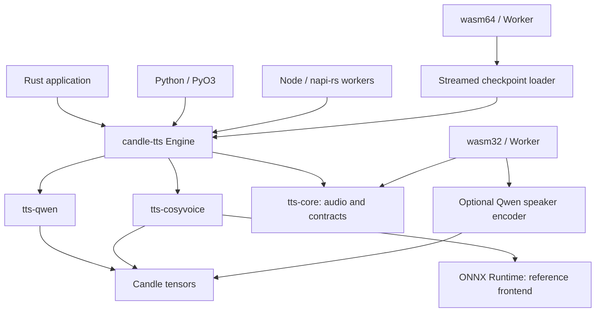
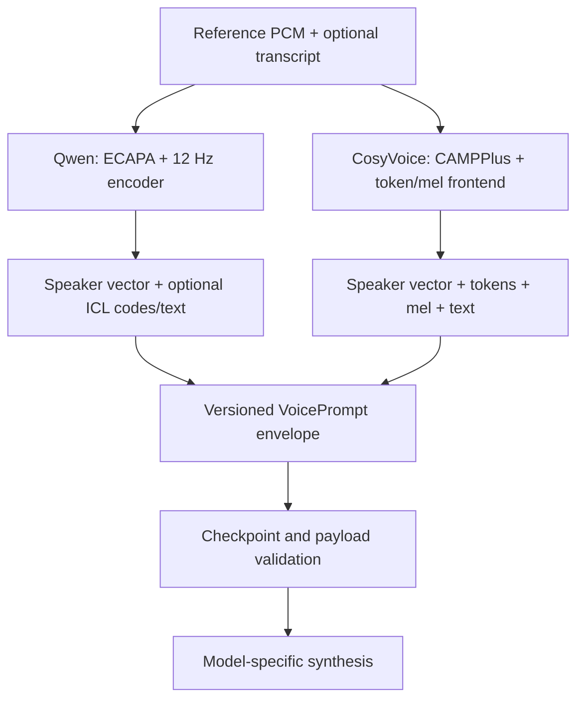

# Architecture

The public boundary is a local model session: load a checkpoint, extract or import
a compatible voice prompt, synthesize PCM, and release the session. Model math
stays outside language bindings. Model downloads are explicit tooling operations.

The browser package reports its actual capabilities. A native feature named
`cuda` or `metal` does not describe browser GPU execution. Large model buffers,
WASM's address space and copying across JavaScript boundaries require their own
validation; successful target compilation alone is not a browser performance test.
The wasm32 package exposes audio utilities and optional speaker extraction from
explicit configuration and weight bytes. The memory64 package uses the same
binding layer and wraps a complete in-memory Qwen model in `Engine`. It imports
checkpoint tensors individually, avoiding a contiguous multi-gigabyte JavaScript
buffer, and computes the same content fingerprint through a streaming hasher.
Memory64 must be supported by the host engine; it does not supply browser GPU
acceleration. CosyVoice's native ONNX frontend is not part of this WebAssembly
boundary. Consult the binding's capability report for the loaded build.

## Model-specific conditioning

The envelope has a schema version, model family, payload format and SHA-256
checkpoint content fingerprint. A model adapter owns shape and value validation.
Fingerprinting reads checkpoint contents once on load; moving identical files
does not invalidate prompts. Changing model files does. It is a compatibility
check, not a signature or an assertion of ownership of a voice.

## Shared code

Share finite PCM validation, file I/O, resampling, binding ownership and error
handling. Keep model mel parameters, windowing, normalization, codec layouts,
attention masks and sampling policies separate unless their equations match.
Resampling uses Rubato and explicitly compensates delay and flushes the tail.
For exact Python comparisons, feed identical PCM already at the native rate.

Qwen's sequence is text prefill → Talker code → acoustic code predictor → codec
decoder. CosyVoice's sequence is speech-token LM → conditional flow → HiFT. Their
common use of transformers does not make their caches or conditioning equivalent.

## Ownership and execution

`Engine` owns a model and its device. Mutable synthesis access prevents concurrent
cache mutation. Python releases its GIL around model work; Node uses worker tasks
and serializes calls on one engine. The application owns scheduling, cancellation
policy and audio playback. No host application state or agent runtime is embedded.

Raw samples and prompt data cross bindings as owned values. Checkpoints stay local.
Unsupported model features and missing ONNX operators are errors, not fallback
audio, fabricated embeddings or an implicit switch to another model.

CosyVoice's released CAMPPlus and speech tokenizer graphs execute through the
optional native ONNX Runtime frontend, matching the upstream deployment boundary.
The language model, flow and vocoder use Candle. The runtime is an explicit shared
library dependency, not bundled implicitly into Python wheels or Node packages.
Within HiFT, the small F0 predictor always runs on CPU in float64 to preserve the
upstream inference precision, including when the other stages use CUDA or Metal.
Its result returns to the selected model device. Account for this transfer when
measuring accelerator performance.

## Extension rule

Add a model crate with a documented checkpoint format and executable Python
oracle. Integrate its typed payload through an adapter. Add a binding only when
it can call the same tested Rust API; do not fork numerical logic into a language
wrapper. Add a shared acoustic primitive after two real callers demonstrate
identical required behavior.
